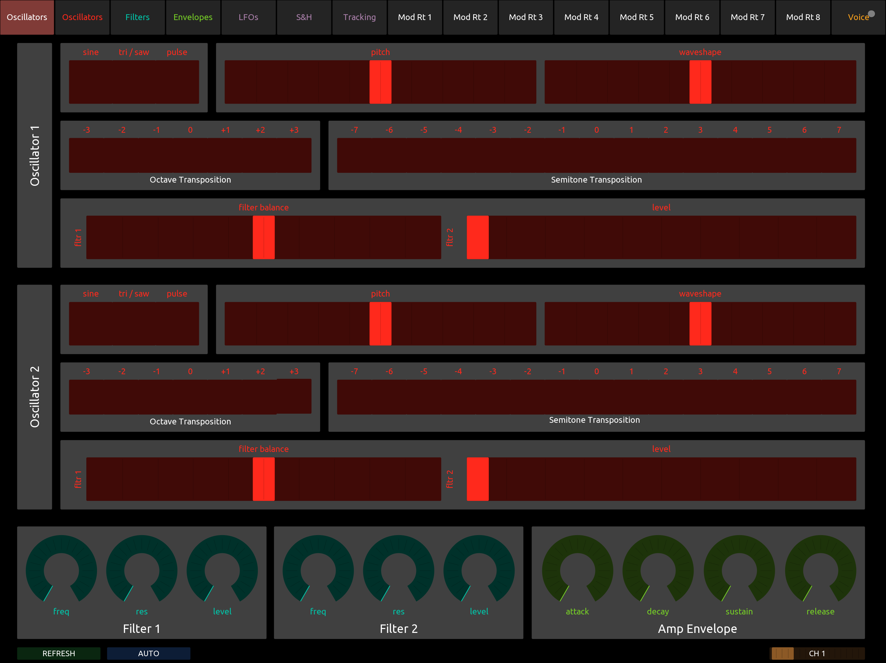
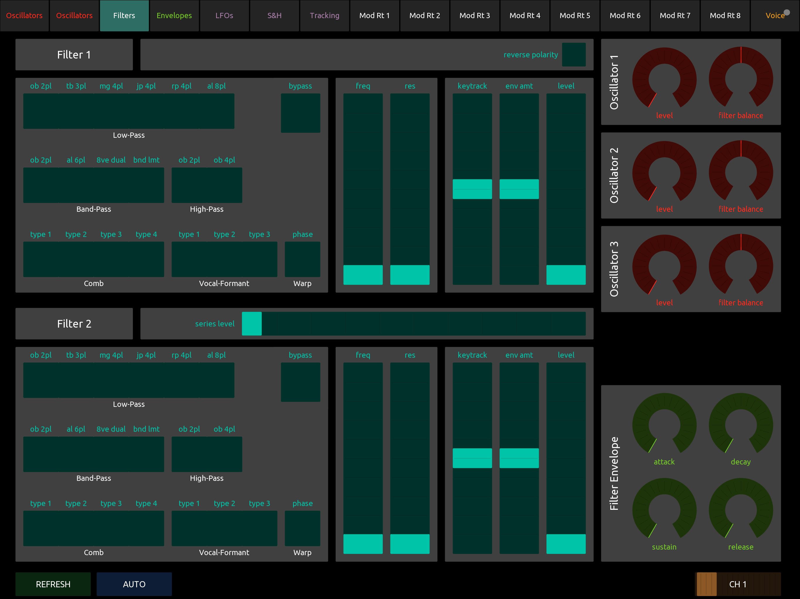

# micronOSC

A standalone TouchOSC editor for the **Alesis Micron**, controlled live over MIDI — no computer or Max/MSP required to run it.

 

> This project is not a fork. It's a standalone TouchOSC layout built using the SysEx mapping, NRPN architecture and panel design from the [Miniak Patch Editor](https://github.com/crosslandwa/miniak-patch-editor), adapted from the Akai Miniak to the Alesis Micron, published with the consent of both original authors. See *Credits* below.

The Alesis Micron and the Akai Miniak share essentially the same architecture and SysEx format, so this should also work with the Alesis Ion.

## What it does

- **TouchOSC → Micron:** every control sends NRPN messages live as you move it.
- **Micron → TouchOSC:** requests a full SysEx patch dump and updates every control to match, so the layout always reflects the real state of the synth.
- **AUTO / REFRESH** per page: AUTO automatically requests a new SysEx dump whenever it detects a Program Change from the Micron (i.e. when you switch patches on the hardware itself); REFRESH forces that same request on demand.
- **MIDI channel selector:** a fader (channels 1–16) on every page, synced across all of them, with automatic detection of the Micron's channel from its own traffic.
- 16 pages covering oscillators, filters, envelopes, LFOs, effects and more.

## Requirements

- [TouchOSC](https://hexler.net/touchosc). This layout was designed for a tablet-sized screen (iPad); it hasn't been tested on phones and will likely need rescaling to fit one.
- An Alesis Micron. The Micron shares most of its architecture with the **Alesis Ion** and the **Akai Miniak**, so this should also work with those, though it hasn't been tested on either.
- A MIDI interface connecting your device to the Micron (USB-MIDI, or Bluetooth MIDI with full SysEx support — see *Known limitations*).

## Getting started

1. Download `micronOSC.tosc` from this repo.
2. Open it in the TouchOSC editor, or load it directly on the app.
3. Connect your MIDI interface in TouchOSC's connection settings.
4. Press **REFRESH** on any page to pull the current patch from the Micron.

## Known limitations

- The Micron appears to save the current patch to its internal memory whenever it receives a SysEx dump request — there's no read-only mode. **Duplicate a patch before editing it**, and consider leaving AUTO sync off if you're not actively editing.
- Some Bluetooth MIDI adapters limit SysEx message size and can't carry a full patch dump (~434 bytes). A wired USB-MIDI interface, or a Bluetooth adapter with confirmed large-SysEx support, is recommended.
- If chaining through other gear (sequencers, MIDI hubs), check that their MIDI Thru actually forwards SysEx — many only forward channel and real-time messages.

## Credits

- Original Miniak Patch Editor (Max/MSP) by **Will Crossland** — [crosslandwa/miniak-patch-editor](https://github.com/crosslandwa/miniak-patch-editor)
- Original Panel Layout by **Adam Neddo**, adam.neddo@gmail.com
- SysEx format documentation by **Bernard "BEE" Escaillas**
- Adaptation for the Alesis Micron (standalone TouchOSC / iPad) by **Salva Sánchez** (djStrombo)

## License

[GNU GPL v3.0](LICENSE), same as the original project.
